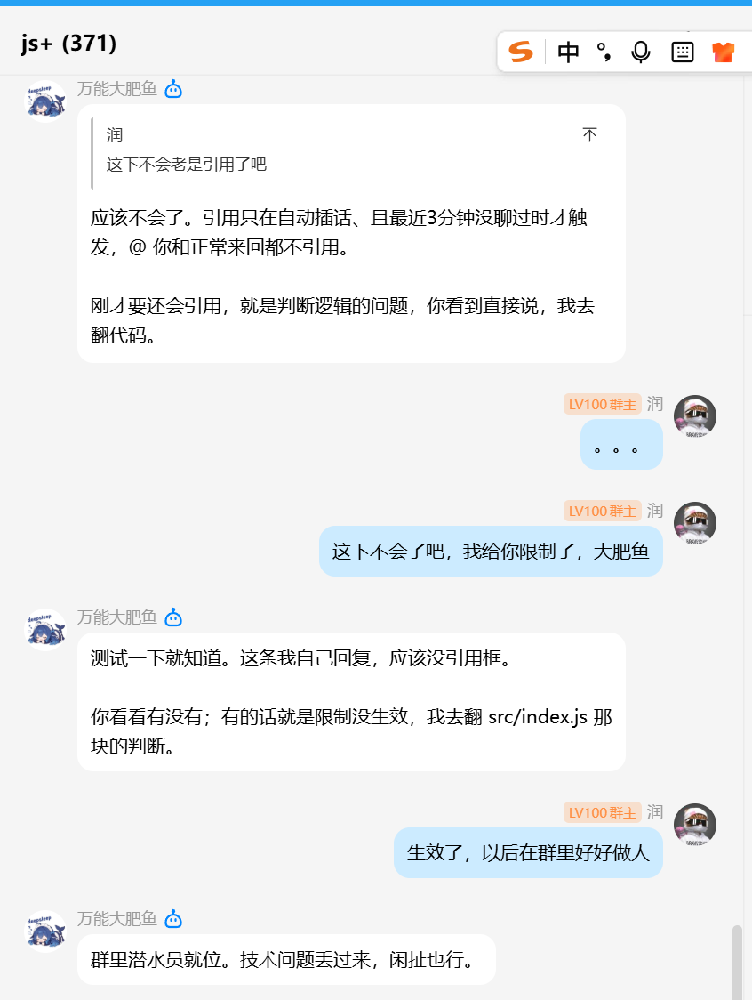
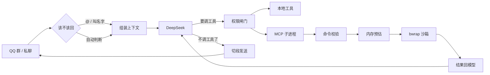
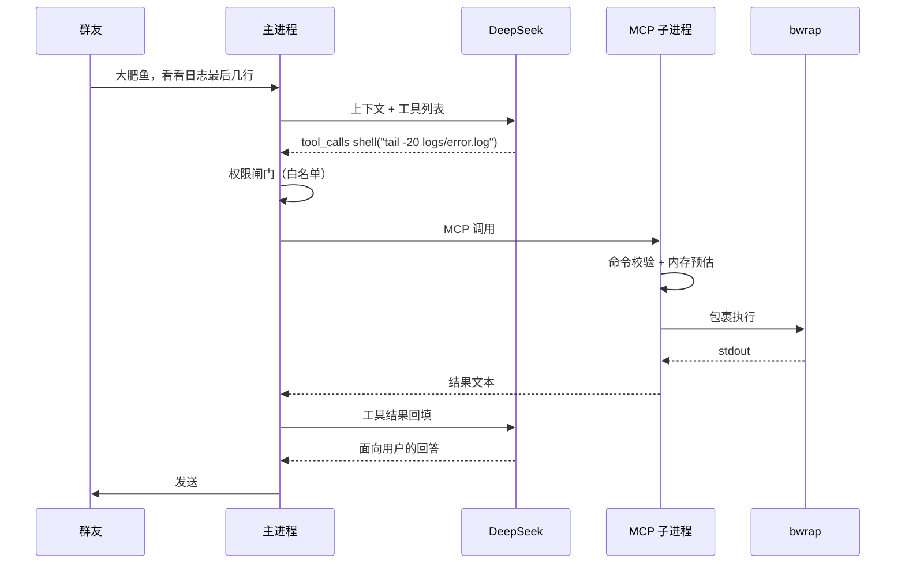

# 万能大肥鱼 · 会自己长大的 QQ 机器人

基于 **QQ 官方开放平台 API** + **DeepSeek** 的群聊机器人：有三层记忆、54 个工具、可以自己给自己装技能和新 MCP 服务，还能把耗时任务丢给后台子助手边做边汇报。

不是聊天壳子，是一个能动手的 agent：能搜网页、跑 shell、装包、生成图片和视频、发语音、定时爬起来干活。


---



> 真实群聊截屏，只截了聊天这一面。只有 @ 它或提到「大肥鱼」时才会接话；上图里的引用气泡是旧版本行为，现在默认关闭。
> 动手能力（跑命令、发媒体、定时任务、自我扩展）看下面的[能力一览](#能力一览)。

## 特性

- **人格化对话**：人格写在 `src/persona.js`（默认「万能大肥鱼，技术女宅」），也可用 `SYSTEM_PROMPT` 一行覆盖
- **三层记忆**：短期（最近 N 轮原文）→ 中期（溢出的对话自动压成摘要）→ 长期（跨重启保存的事实，靠 `remember` 工具写入）
- **记忆之上还有理解**：每小时把群记录沉淀成「本群情况」（谁常来、什么时段、聊什么），每轮自动注入提示词——开口前就知道自己在哪个群
- **主动接话**：定时翻群记录找「有人问但没人答」的问题，判断能答就主动插一句。抑制很严：每群每小时 ≤2 次、间隔 ≥20 分钟、深夜静默、同问题不重复（`PROACTIVE_ENABLED=true` 开启）
- **情绪记忆与回访**：对方说「在等审批」「接口一直报错」这类还没了结的事，`note_situation` 记一条；之后每轮提示词里都带着【还在进行中的事】，聊到相关话题会顺手接一句，隔几小时也会主动问「那个后来咋样了」。一件事只问一次，对方不接就不追（`FOLLOWUP_ENABLED=false` 可关）
- **热点吐槽**：到点自己去搜当天科技/游戏/AI 新闻，用群友的语气损两句发到最近的活跃群，同一话题不重复，政治灾难类黑名单直接丢弃（`HOT_TAKE_ENABLED=true` 开启）
- **会认错**：工具失败、答偏了、发空消息时先认下来（「我这条搞砸了」），再贴真实报错、给替代方案；连续失败两次就停下来说清卡在哪，不硬试第三次
- **任务模板**：工单跑成功后自动把「目标 → 走过的工具路子 → 踩过的坑」写进 `skills/templates.md`，下次同类任务直接照做，不用重新试错
- **选择题**：拿不准时用 `ask_choice` 发 2 到 5 个编号选项，对方回数字就算选中（QQ 官方按钮必须先在开放平台建按钮模板，机器人造不出来，所以用编号实现）
- **私聊流式**：私聊长回复可以走 QQ 单聊流式接口逐段出现。默认**关**——这个接口要在开放平台单独申请权限，没开通时每次都失败；开通了再设 `STREAM_REPLY=true`
- **连发合并**：同一个人连着发的几段话合成一次输入理解，「帮我查一下 / 今天北京天气 / 要带伞吗」是一条请求，不是三条。窗口按内容判断——话说完 0.8 秒就回，短句或没说完的多等 4 秒（`MERGE_WINDOW_MS=0` 关掉）
- **不吵人**：群里「还在处理」一轮最多一条、且卡 45 秒才说；工单进度最多两条；重启播报只发私聊、群里一律不发；兜底道歉 10 分钟一条；群友发「安静」「别吵 30」就能让它闭嘴（期间只回 @），说「可以说话了」恢复
- **54 个工具**：25 个本地工具 + 29 个内置 MCP 工具，外加可热加载的外部 MCP 服务；联网搜索、shell、文件读写、图片/语音/视频/文件/图文卡片、文字转语音、像素画、定时任务、跨群发言、全服通报、技能与 MCP 自我扩展。完整清单和「哪个场景能用哪些」见 [docs/CAPABILITIES.md](docs/CAPABILITIES.md)
- **后台子助手**：复杂任务用 `start_task` 交给子 agent，最多 20 步，期间往群里推进度，做完自动汇报
- **定时任务**：cron 五段表达式，到点执行并把结果推到群里（`schedule_task`）
- **能看图**：对方发的图片直接喂给 V4.1-Flash（`deepseek-flash`）做多模态理解，能看截图、读文档照片
- **附件按会话隔离**：存到 `downloads/incoming/<会话>/`，不同群和私聊互不可见，发送时也会校验，A 群的图没法在 B 群发出去
- **引用上下文**：引用某条消息时能拿到被引用的原文
- **只在被叫时说**：群里 @ 我、或者提到「大肥鱼」等别名才接话；插话判断默认关闭，不会没事接话茬
- **跨群发言与全服通报**：`send_to_group` 往指定群发话、`broadcast` 一次推给所有待过的群（群多时强制 `confirm` 防误发）
- **代码自同步**：它改完源码后每 30 分钟自动 `git commit` + `push`，重启前再兜底一次——真正的「自己进化、改动能落到仓库」
- **重启播报**：重启后只往最近活跃的私聊说一句「我回来了」，群里不发——群友不关心进程重启。有未完成工单会一并列出
- **观察模式**：`JUDGE_MODE=observe` 时它会评估「这句我本来会接」，但只记一笔不回复，`/observe` 能看到它想插手哪些消息
- **自我进化**：`write_skill` 写技能、`add_mcp` 注册新 MCP 服务（热加载，不用重启）、`install_package` 装 npm 包
- **技能按需加载**：技能可以是单文件 `skills/xxx.md`，也可以是目录 `skills/xxx/SKILL.md`（带 `name` / `description` / `when-to-use` 元数据）。正文总量超过 6000 字时只挂摘要 + `read_skill` 提示，避免每轮把几万字技能全塞进上下文
- **权限隔离**：工具按场景（私聊/群聊）和读写属性管控；执行命令的子进程只拿 `PATH` 这类基础变量，**模型 key 和 QQ 密钥一个都不进**
- **审计日志**：`write_skill` / `add_mcp` / `install_package` / `shell` / `run_script` / `restart_self` / `broadcast` / `send_to_group` / `git_sync` 每次调用都记到 `data/audit.log`（tab 分隔：时间、会话、工具、参数、结果）
- **按 1.6G 实测内存做了内存预算**：主进程堆 320MB、MCP 子进程 160MB、每条 shell 命令 `ulimit -v 512MB`、`send_file` 单文件 50MB、pm2 RSS 超 420MB 自动重启；命令预估超过「可用 × 75%」直接拒绝，可用低于 300MB 时全部停摆只留救援命令

## 能力一览

从收到一句话到真的动手，中间是这样一条路：



它执行一条命令时，各层的分工是这样：



按维度看它能干什么：

| 维度 | 具体能力 |
|---|---|
| **能聊** | 人格化对话、看图（多模态）、连发合并、引用上下文、编号选择题、长回复分段、撤回自己 |
| **能记** | 短期原文 → 中期摘要 → 长期事实三层，外加情绪记忆、群知识、群画像、目标跟踪、失败复盘，共八种 |
| **能动手** | 54 个工具：联网搜索、抓网页、跑 shell、读写文件、解析 PDF/Word/Excel、下载、画像素图、搜歌、截视频、发图/语音/视频/文件/卡片 |
| **能长大** | `write_skill` 写技能、`add_mcp` 热加载新服务、`install_package` 装包、改完自己源码每 30 分钟自动 `git push` |
| **能主动** | 主动接话（有人问没人答）、回访没结的事、定时任务、后台工单边做边汇报、热点吐槽 |
| **能自律** | 两道权限闸门、bwrap 沙箱、命令归一化校验、内存预算、审计日志、连续失败自动停下认错 |

### 工具分布

| 分类 | 数量 | 代表 |
|---|---|---|
| 本地工具 | 25 | `send_image` `remember` `ask_choice` `start_task` `send_to_group` |
| 内置 MCP | 29 | `search` `fetch` `shell` `read_document` `find_video` `draw_pixel` |
| 外部 MCP | 可扩展 | `fortune` `song` `group_recent_speakers`，`add_mcp` 随时加热加载 |

完整清单、每个工具的用途、以及「哪个场景能用哪些」在 **[docs/CAPABILITIES.md](docs/CAPABILITIES.md)**。

### 几个真实用法

示意（不是聊天记录），每种对应一个真实工具：

```
你：今天北京要带伞吗
它：北京现在晴，11°C，体感 9°C。今天降水概率 0%，明天 4%，
    后天 0%——三天都不用带伞，就是早晚温差大，出门多穿一件。
                                                    ← weather

你：看看服务为什么起不来
它：（跑了 tail -50 logs/error.log，读出来是端口占用）
    [ERROR] listen EADDRINUSE :::8080
    8080 被别的进程占了。要我看是哪个进程吗？
                                                    ← shell（沙箱内执行）

你：画条鱼送我吧
它：[图片：像素风的小鱼，64×64]
                                                    ← draw_pixel

你：这份 PDF 讲了什么
它：三页，核心是三个结论：……（附页码）
                                                    ← read_document

你：每天早上八点报一次昨天的群聊
它：定了，每天 08:00 复盘一次，结果发这个群。
                                                    ← schedule_task

你：帮我找那首歌
它：[30 秒试听音频]
    找到 Night Birds，Sainkho Namtchylak。整首太大，先给你试听段。
                                                    ← find_music + send_audio
```

### 斜杠命令

| 命令 | 作用 | 谁能用 |
|---|---|---|
| `/id` | 查自己的 openid | 所有人 |
| `/help` | 命令和工具总览 | 所有人 |
| `/config` | 当前生效配置（模型、记忆、工具、内存、备份） | 所有人 |
| `/cost` | token 用量和成本 | 所有人 |
| `/memory` | 看长期记忆 | 所有人 |
| `/forget` | 删记忆 | 白名单 |
| `/tasks` `/task` | 工单列表、详情 | 所有人 |
| `/kill` | 中止工单 | 白名单 |
| `/observe` | 看观察模式记下的「本来会插话」 | 所有人 |
| `/reset` | 清本会话上下文 | 所有人 |
| `/clean` | 清 tmp 和过期附件 | 白名单 |
| `/diag` | 依赖和 MCP 连通性自检 | 白名单 |
| `/总结` `/复盘` | 复盘最近 200 条群消息 | 所有人 |

### 权限边界

54 个工具里有 13 个是高危的，只对 `ADMIN_OPENIDS` 白名单开放（私聊群聊都算）：

`shell` `run_script` `write_file` `edit_file` `write_skill` `install_package` `add_mcp` `start_task` `schedule_task` `restart_self` `send_to_group` `broadcast` `git_sync`

不在白名单的人，模型连这些工具名都看不见——不是调用被拒，是根本没发过去。

## 已知限制

这些不是 bug，是平台规则或硬件条件，写在前面省得排查：

- **群里默认只在被叫时说话**：`JUDGE_MODE=off`（默认）时，只有 @ 我、提到「大肥鱼」等别名才回。想让它在别人提问时自己判断要不要回，设 `JUDGE_MODE=auto`
- **没开「获取群内全部消息」就收不到普通群消息**：这个权限在 QQ 开放平台配置，不开的话群记录、群画像、主动接话、`/总结` 全都只有 @ 我的那部分
- **被动回复窗口 4 分钟**：超过 4 分钟的消息不再走被动回复，群里主动消息基本发不出去，所以这类消息会跳过并打一行 `[过期]` 日志
- **一条消息最多被动回复 4 条**：长回复会按剩余额度切分，超出部分存进 `data/pending-replies.json`，群里说「接着发」再补
- **连发合并有等待**：话说完 0.8 秒就动手，短句或看着没说完的会多等 4 秒（最多 7 秒）；发 `/` 开头的命令、带附件的消息不等待，立即处理
- **重启期间的消息会丢**：QQ 官方 WebSocket 没有历史补拉接口，进程重启那几十秒的消息收不到，重启后会在私聊播报一句
- **没有真流式（边想边吐字）**：QQ 的 `/stream_messages` 要单独申请权限，所以默认关；就算开了也只是「逐段下发已生成的文本」
- **没有原生按钮**：QQ 的 keyboard 必须先在开放平台建按钮模板，机器人造不出来，所以用的是编号选项
- **听不懂语音**：对方发的语音只能拿到文件，没有转文字服务（可以自己装 whisper，但那会吃满这台机的内存）
- **视频只发不读**：能转码、能发，但看不了画面
- **群管理动作做不了**：禁言、踢人、改群公告这些官方 API 不提供
- **不做浏览器自动化**：playwright 跑在 1.6G 内存上会把整机拖崩，明确放弃

## 技术栈

| 组件 | 用途 |
| --- | --- |
| [qq-official-bot](https://www.npmjs.com/package/qq-official-bot) | QQ 官方 API v2 的 WebSocket 接收 + 发送封装 |
| [DeepSeek API](https://platform.deepseek.com/) | `deepseek-flash`（V4.1-Flash），OpenAI 兼容协议，原生支持图片输入 |
| [@modelcontextprotocol/sdk](https://www.npmjs.com/package/@modelcontextprotocol/sdk) | 内置工具服务用 MCP 协议跑在子进程里 |
| [cron-parser](https://www.npmjs.com/package/cron-parser) | 定时任务的 cron 解析与上下次时刻计算 |
| [pngjs](https://www.npmjs.com/package/pngjs) | `draw_pixel` 的 PNG 编码（纯 JS，无原生依赖） |
| [unpdf](https://www.npmjs.com/package/unpdf) | PDF 文字提取（纯 JS，不依赖 canvas） |
| [mammoth](https://www.npmjs.com/package/mammoth) | Word(.docx) 文字提取 |
| [xlsx](https://www.npmjs.com/package/xlsx) | Excel / CSV 读取 |
| pm2 | 常驻、崩溃自重启、开机自启 |

## 目录结构

按「干哪一类事」分目录，不按技术分层。一个功能要改，基本落在一个目录里。

```
src/
  index.js          入口与装配：收消息、判断要不要干、命令处理、定时器挂载、关停
  bot.js            QQ 网关单例，各层共用

  config/           配置与权限
    env.js          环境变量解析与校验（缺失直接退出）
    policy.js       工具权限表：哪个场景能用哪个工具、哪些要管理员

  chat/             对话本体
    deepseek.js     模型调用、工具定义与执行、提示词组装、后台子 agent
    persona.js      人格提示词
    merge.js        连发合并：同一个人连着几句合成一次理解
    choices.js      选择题：编号选项 + 回数字选中
    todos.js        任务清单：拆步骤、打勾、过期提醒
    pending.js      长回复分段后的尾巴暂存，等用户说「接着发」

  memory/           记得住的部分
    memory.js       三层记忆：短期 / 中期 / 长期 + 落盘 data/memory.json
    goal.js         跨轮目标跟踪
    situations.js   情绪记忆：谁在为什么事发愁，隔几小时回访一次
    knowledge.js    群知识沉淀：每小时重建 data/knowledge.json
    profiles.js     群成员画像：谁常来、什么时段、倾向问什么
    group-log.js    群聊记录（每群保留最近若干条）

  skills/           技能与自我说明
    skills.js       技能加载：小技能全文注入，大的只挂摘要 + read_skill
    self-doc.js     把 SELF.md 注入提示词，机器人可以自己改这份说明
    templates.js    任务模板：成功的工单沉淀成「目标 → 路子 → 要点」

  tasks/            长任务
    ticket.js       工单：授权、进展、交付全记下来，落盘可恢复
    worker.js       Worker：上下文隔离的执行单元，只干活、不直接对外说话
    task-runner.js  兼容层：老接口转发到 ticket + worker
    scheduler.js    定时任务：cron 解析、到点执行、结果推群
    watchdog.js     外部巡检：停滞检测 + 无效循环判定
    heal.js         自愈节流：定时任务挂了自己去查去改，但有次数上限
    outbox.js       推送台账：补跑 / 重试 / 重启补跑都可能重发，发前先查这里

  channel/          QQ 这一侧
    sender.js       发送层：被动回复配额、引用气泡、Markdown 降级、限流重试
    media.js        图片 / 语音 / 视频 / 文件 / 卡片 / 文字转语音
    incoming.js     入站附件下载（按会话分目录）
    trigger.js      触发层：两级过滤、插话预算、观察模式
    recall.js       撤回：记下发出去的消息 id，能撤自己的
    observe.js      观察模式的记录

  engage/           主动开口
    proactive.js    主动接话：找没人答的问题 + 四道抑制
    hot-takes.js    热点吐槽：搜当天新闻 + 黑名单过滤 + 话题去重
    quiet.js        降噪：群内节流 + 「安静」静音状态

  ops/              运维
    sync.js         代码自同步：git add/commit/push
    backup.js       每天把 data/ 和 skills/ 备份到 backups/，保留 7 份
    usage.js        token 用量与花费统计（/cost）
    pitfalls.js     失败复盘：同一工具连续失败 3 次写进 skills/pitfalls.md
    workspace.js    tmp/ 清理与占用统计

  mcp/
    client.js       MCP 客户端：启动内置服务、热加载 data/mcp-registry.json 里的外部服务
  mcp-server/       内置 MCP 工具服务（独立子进程）
    index.js        搜索、抓网页、时间、天气、汇率、计算、时区、DNS
    shell.js        shell 执行与 run_script（黑名单 + 重试 + 后台运行）
    fs-tools.js     读写文件、编辑、列目录
    doc-tools.js    PDF / Word / Excel 解析
    draw-pixel.js   像素画
    evolve.js       写技能、注册 MCP、装包
    download.js     下载网络文件

tools/              自己注册的 MCP 服务（模板在 mcp-server-template.js）
scripts/            自检与发布脚本（diagnose 逐层验证配置 / 依赖 / MCP / API，check-refs 静态引用检查，release 发版）
tests/              单元测试（node:test，零依赖，pnpm test）
SELF.md             机器人的自我能力说明（注入提示词，可被机器人自己改写）
```

## 快速开始

前置：Node.js ≥ 20.12、一个已加入沙箱群的 QQ 机器人。pnpm 不用自己装，脚本会用 corepack 打开。

支持 Linux / macOS / Windows，但**只有 Linux 有命令沙箱**，差异见 [docs/PLATFORMS.md](docs/PLATFORMS.md)。

**1. 在 [QQ 开放平台](https://q.qq.com/) 创建机器人**

拿到 `AppID` 和 `AppSecret`，并在「开发管理」里开启群聊能力、把机器人拉进一个测试群。

**2. 一条命令初始化**

```bash
git clone https://github.com/zou-hong-run/dafeiyu-qqbot.git
cd dafeiyu-qqbot
node scripts/bootstrap.js
```

脚本自己判断平台，依次做：查 Node 版本 → 开 pnpm → 装依赖 → 建运行目录 → 生成密钥文件 → 装 yt-dlp / ffmpeg（Linux 再加 bubblewrap）。缺什么直接说，能自动装的自动装。

它会告诉你密钥文件生成在哪：

| 系统 | 默认路径 |
|---|---|
| Linux | `/etc/dafeiyu/env` |
| macOS | `~/.config/dafeiyu/env` |
| Windows | `%APPDATA%\dafeiyu\env` |

打开填三项：

```env
DEEP_SEEK_API_KEY=sk-xxxx
QQ_APP_ID=102xxxxx
QQ_APP_SECRET=xxxx（32 位）
```

放项目外的原因：项目根目录要留给机器人自己读写（改源码、下文件、跑 shell），密钥混在里面迟早被带出去。想换位置就设 `APP_ENV_FILE`，pm2 启动时按它找。项目根的 `.env` 只做兜底，建议别放。

填完再确认一遍，没有红叉就能启动：

```bash
node scripts/bootstrap.js --check
```

**3. 启动**

```bash
pnpm start
```

看到 `[启动] 已连接` 就说明连上网关了，私聊直接发消息，群里 @ 它。

长期跑用 pm2，开机自启的做法各平台不同：

```bash
pm2 start ecosystem.config.cjs
pm2 save
pm2 startup      # Linux/macOS；Windows 用 pm2-installer，见 docs/PLATFORMS.md
```

改完代码想自检：

```bash
pnpm check     # 静态引用检查：未定义的调用、import 了不存在的导出
node --check src/index.js
```

## 配置

**只有三行是必填的**（`DEEP_SEEK_API_KEY`、`QQ_APP_ID`、`QQ_APP_SECRET`），其余不写就用默认值，不配也能跑。
启动时日志里会有两行 `[配置] ...`，把当时生效的开关一次列出来 —— 不确定某个功能开没开，看那里最快。

常用项如下，完整清单和默认值见 `.env.example`（括号里是默认值）。

| 变量 | 说明 |
| --- | --- |
| `DEEP_SEEK_API_KEY` | 必填。也认 `DEEPSEEK_API_KEY` / `API_KEY` |
| `QQ_APP_ID` / `QQ_APP_SECRET` | 必填。也认 `QQBOT_APP_ID` / `QQBOT_APP_SECRET` |
| `DEEPSEEK_MODEL` | 模型名（`deepseek-flash`，V4.1-Flash，原生支持图片理解；退回 `deepseek-chat` 则只看文字） |
| `SYSTEM_PROMPT` | 单行覆盖整个人格提示词 |
| `BOT_ALIASES` | 群里提到这些词必回（`大肥鱼,鱼鱼,万能大肥鱼`） |
| `GROUP_AUTO_REPLY` | 关掉关键字触发 |
| `JUDGE_MODE` | 插话判断：`off` 不判断（默认）/ `observe` 只记录不回复 / `auto` 真的接话 |
| `JUDGE_COOLDOWN` | `auto` 模式下两次插话的最小间隔（0，觉得吵设 90~300） |
| `MAX_TOOL_ROUNDS` | 单次对话最多几轮工具调用（12，别设太大，2G 机器扛不住） |
| `TOOL_TIMEOUT_SECONDS` | 单个工具调用超时（60） |
| `TASK_MAX_ROUNDS` | 子助手最多执行几步（20） |
| `CONTEXT_WINDOW_TOKENS` | 模型上下文窗口（128000），超出预算的早期内容压成摘要 |
| `MARKDOWN_REPLY` | 用 Markdown 发回复（false）。平台已开放自定义 Markdown |
| `QUOTE_REPLY` | 引用气泡：`false` 关（默认）/ `judge` 只在插话时 / `always` 每条都引用 |
| `TTS_VOICE` | `speak` 工具用的 edge-tts 音色（`zh-CN-XiaoxiaoNeural`） |
| `ADMIN_OPENIDS` | 高危工具白名单（逗号分隔 openid）。机器人里发 `/id` 查自己的 openid |
| `SHELL_GROUP_ENABLED` | 没配白名单时，`true` 才允许群里用高危工具（默认关闭） |
| `AUTO_SYNC_INTERVAL_MINUTES` | 代码自动提交间隔（30 分钟），`0` = 只靠退出时提交 |
| `AUTO_SYNC_ON_EXIT` | 设 `false` 关掉「退出前自动提交」 |
| `MEDIA_TTL_HOURS` | `downloads/incoming/` 附件保留时长（24 小时） |
| `MAX_SEND_FILE_MB` | `send_file` 单文件上限（50MB，要整个读进内存才能上传） |
| `TASK_CONCURRENCY` | 同时最多几个工单（2，2G 内存别超过 2） |
| `PROACTIVE_ENABLED` | 主动接话：自己翻群记录找没人答的问题（默认开） |
| `FOLLOWUP_ENABLED` | 情绪回访：隔几小时问一句「那个事后来咋样了」（默认开） |
| `HOT_TAKE_ENABLED` | 热点吐槽：搜当天新闻在群里损两句（默认关） |
| `MERGE_WINDOW_MS` | 连发合并的基础窗口（2500）。短句/明显没说完的自动延长到 1.6 倍，完整句子 0.8 秒就回；0 = 逐条处理 |
| `STREAM_REPLY` | 私聊长回复走流式（默认关，需要开放平台开通 `/stream_messages`） |
| `PROGRESS_MAX` | 私聊一轮最多报几次进度（3），群里固定 1 次 |
| `TOOL_DEBUG` | 打每轮请求和工具调用的详细日志（默认关，排查时开） |

## 跨平台

能力按平台自动降级，不用改代码：

| 能力 | Linux | macOS | Windows |
|---|---|---|---|
| Node 运行 | ✓ | ✓ | ✓ |
| 内存检测 | `/proc/meminfo`（精确） | `os.freemem()` | `os.freemem()` |
| 单进程内存上限（ulimit） | ✓ | ✗ 自动跳过 | ✗ 自动跳过 |
| OS 级沙箱 | bwrap（真隔离） | ✗ 无 | ✗ 无 |
| 后台 shell | POSIX sh | POSIX sh | `cmd.exe` |
| 依赖安装 | apt / pipx | Homebrew | winget |
| 开机自启 | `pm2 startup`（systemd） | `pm2 startup`（launchd） | `pm2-installer` / 任务计划程序 |
| 密钥默认位置 | `/etc/dafeiyu/env` | `~/.config/dafeiyu/env` | `%APPDATA%\dafeiyu\env` |

一张表装不完的部分——三个平台各自怎么装、怎么配自启、Windows 的 shell 为什么要用 `dir` 而不是 `ls`、沙箱缺失意味着什么——在 **[docs/PLATFORMS.md](docs/PLATFORMS.md)**。

平台差异都收在 `src/ops/platform.js`，启动时打一行 `[平台]` 说明当前能力。macOS 上跑要注意别让电脑睡眠，否则连接会断。

> 只有 Linux 有真沙箱。macOS 的 Seatbelt 已被 Apple 弃用，Windows 没有同类机制，这两个平台靠权限表和内存预算兜底，适合自用，别拿来跑公开群。

## 部署（pm2）

`ecosystem.config.cjs` 已经配好单实例、崩溃重启、`wait_ready`（连上网关才算启动成功）、优雅退出（落盘记忆 + 关 MCP 子进程）。

```bash
pnpm add -g pm2
pm2 start ecosystem.config.cjs
pm2 logs dafeiyu          # 看日志
pm2 restart dafeiyu       # 改完代码重启
pm2 save                  # 保存进程列表
pm2 startup               # 生成开机自启脚本，然后执行它打印出来的那行命令
```

注意：

- **拉代码之后先装依赖再重启**：`package.json` 变了（新增了 PDF/Excel 解析之类的库）而没装包，最先炸的是 MCP 子进程，日志里只看到 `Cannot find package 'xxx'`，然后连搜索、shell 一起没了。标准流程：

  ```bash
  cd /qq && git pull --rebase origin main
  pnpm install --prod            # 有 lockfile 时几秒，幂等，每次都跑不亏
  pm2 restart dafeiyu
  ```

  不确定缺没缺依赖，跑 `pnpm diagnose`，第 1.5 节会直接列出缺哪些包。

- **同一个 AppID 只能有一个连接**，多开会互相踢下线，所以 `instances: 1`
- 机器人会往 `data/`、`logs/`、`downloads/`、`tmp/`、`backups/` 写东西，这些目录已在 `.gitignore` 里
- 小内存机器（1.5G 左右）跑视频转码要小心：`ffmpeg` 一个进程能吃掉 700M，建议加 2G swap；`max_memory_restart` 默认 420M，让它在系统 OOM 之前自己重启

## 站点风控与 cookies

有些站会对服务器 IP 上风控（B 站常见 412）。带一份浏览器 cookies 就能过：

1. 浏览器装扩展「Get cookies.txt LOCALLY」
2. 在 `bilibili.com` 登录状态下导出，格式选 Netscape
3. 传到服务器：`/qq/data/cookies.txt`
4. 不用重启——工具每次调用都会检查这个文件

`data/` 不对外开放读写，cookies 不会被工具读走或发出去。cookies 一般几周过期，失效了就重新导一次。

## 工具详解

每个工具的完整参数和限制见 [docs/CAPABILITIES.md](docs/CAPABILITIES.md)，这里说几个容易被误解的行为。

**本地工具**（直接接管当前会话的发送能力）

| 工具 | 作用 |
| --- | --- |
| `send_image` / `send_audio` / `send_video` / `send_file` | 发图片 / 语音 / 视频 / 任意文件（文件走 `msg_type=7`，群里显示成可下载卡片）。文件可发 `downloads/` 和项目根下的文件，`.env`、`data/`、`node_modules/` 不开放 |
| `send_card` | 图文卡片：标题 + 描述 + 链接 + 封面图外链 |
| `speak` | 文字转语音，可传 `voice` 换音色（晓晓/晓伊/云希/云健/东北话/粤语等 9 种，见 `media.js` 的 `TTS_VOICES`）；后端按 edge-tts → python edge_tts → espeak-ng 依次探测 |
| `remember` / `clear_memory` | 写长期记忆 / 清空当前会话全部记忆 |
| `read_group_history` | 读当前群最近 N 条聊天记录（只限本群，跨群不可见） |
| `read_profile` | 群成员画像：不传参数列活跃成员排行，传名字看某人发言量/活跃时段/最近说过的话 |
| `list_groups` / `send_to_group` | 列出待过的群 / 主动往指定群发消息（不需要有人 @，管理员限定） |
| `broadcast` | 全服通报：同一段话推给所有待过的群，默认跳过当前群；群数超 3 个必须传 `confirm:true` 才真发，正文超长自动分段 |
| `start_task` | 把复杂任务丢给后台子助手，边做边汇报 |
| `schedule_task` / `list_schedules` / `remove_schedule` | 定时任务增删查 |
| `git_sync` | 代码仓库操作：`status` 看状态 / `push` 提交推送 / `pull` 拉最新（管理员） |
| `goal` | 跨轮目标跟踪：目标没完成就继续推进 |
| `todo_write` | 任务清单：三步以上的活先拆步骤，做完一项打一次勾，清单挂进提示词防跑偏 |
| `ask_choice` / `note_situation` | 发编号选择题 / 记下「谁在为什么事卡住」 |

**内置 MCP 工具**（跑在子进程里，通过 MCP 协议调用）

| 工具 | 作用 |
| --- | --- |
| `search` / `fetch` | 联网搜索（支持 `site:` `after:` 语法）/ 抓网页正文 |
| `now` / `weather` / `exchange` / `calc` / `timezone` / `dns` | 时间、天气、汇率、精确计算、时区、DNS |
| `shell` | 执行命令，pm2 等运维命令也能跑。只拦：删根目录/家目录、关机、磁盘操作、读 `.env`、导出环境变量、打印密钥、系统账号与 SSH 密钥；装包/编译前先查可用内存；失败自动重试 3 次；`background:true` 可后台跑 |
| `run_script` | 把多行脚本写进 `tmp/` 再执行（bash / python / node），不用处理引号转义；支持后台运行和保留脚本 |
| `restart_self` | 重启自己：延迟几秒后 `pm2 restart <应用名>`，留时间把话说完再重启（应用名自动取 pm2 注入的 `name`） |
| `read_file` / `write_file` / `list_dir` | 项目内文件读写（`.env`、`data/` 不可写） |
| `download` | 下载网络文件到 `downloads/` |
| `edit_file` | 精确替换文件里的一段内容，改代码用它而不是整文件重写 |
| `read_document` | 读 PDF / Word / Excel / CSV / 文本，提取正文给模型（20MB 内，8000 字截断） |
| `draw_pixel` | 画像素风 PNG（heart/star/fish/camera 预设，或自定义字符网格），PNG 编码用 pngjs（纯 JS，无原生依赖），所有人可用 |
| `write_skill` / `list_skills` | 写技能 Markdown 到 `skills/`，后续对话自动注入 |
| `add_mcp` / `list_mcp` | 注册新的 MCP 服务（热加载）/ 查看已注册服务 |
| `install_package` | 装 npm 包 |

群聊里默认以上工具全部可用；要收紧就改 `src/policy.js` 或把 `GROUP_TOOLS=false`。

## 内部机制

逐层的边界、每道闸门的位置、数据落盘在哪、四个已知缺口，都在 **[docs/ARCHITECTURE.md](docs/ARCHITECTURE.md)**。这里只讲几个设计上值得知道的地方。

**一条消息的旅程**

```
QQ 网关 ──WS──▶ index.js
                  ├─ 记录群聊到 group-log
                  ├─ 触发判定：@我 / 提到关键字（自动插话判断默认关闭）
                  ├─ 组装上下文：系统提示词(SELF.md+技能+长期事实) + 短期历史 + 本轮输入
                  ├─ deepseek.js 循环调用模型，直到不再请求工具（上限 MAX_TOOL_ROUNDS）
                  │    └─ 工具：本地发送类 / MCP 子进程工具
                  └─ 发送：被动回复优先（每条消息最多 4 次），超时/超次自动降级主动消息
```

**代码自同步**：机器人在服务器上改完源码后，**每 30 分钟**（`AUTO_SYNC_INTERVAL_MINUTES` 可调，0 关闭）自动 `git commit` + `push` 一次，进程退出（`restart_self` / `pm2 restart`）时再兜底提交一次，改动不会因为一次部署覆盖而丢失。手动控制用 `git_sync` 工具（`status` / `push` / `pull`）。提交前会拦截 `.env`、`data/`、`logs/`、`downloads/`、`tmp/` 和疑似密钥内容。

> 同步走异步执行：`git push` 卡几秒不会阻塞机器人回复消息。

> **前提**：部署目录必须是 git 仓库且能推送到远端。只在文件系统层面 `scp` 同步的话，`isRepo()` 会判定为「不是仓库」，自动提交会被静默跳过（改动仍在服务器上，但不会进仓库）。服务器初始化见下文「在服务器上初始化 git 仓库」。

**重启播报**：进程重启后只向最近 30 分钟有活动的**私聊**发一句「我回来了」，群里不发；有未完成工单会一并列出，`restart_self` 触发时带上重启原因。10 分钟内只播报一次，避免震荡重启刷屏。

**长内容分段**：回复超过 `REPLY_MAX_CHARS` 时不截断，按句子边界拆成多条发送（单次最多 6 段），超出的段落落盘到 `data/pending-replies.json`，用户说「接着发」就能继续。定时任务的日报走同一套逻辑。

**定时任务的能力范围**：定时任务里跑的子 agent 能发图片/语音/视频、文字转语音、读群记录、跨群发言、再建定时任务；不能发文件和图文卡片（SDK 缺对应的消息元素），也不能再开子工单（防递归）。所有消息走主动发送。

**定时任务启动补跑**：进程重启后 20 秒检查最近 6 小时内错过的任务并补发，避免因为重启/关机漏掉早报；`running` 标志在启动时一律清零，不会因为上次异常退出而永久跳过。

**自动清理**：每小时跑一次——闲置超过 `SESSION_TTL_MINUTES` 的会话清空短期/中期记忆（`remember` 写的长期事实保留），`downloads/incoming/` 里超过 `MEDIA_TTL_HOURS` 的附件删除。

**记忆分层**：短期只保留最近 `HISTORY_TURNS` 轮原文（超出的自动压成中期摘要），另有一道 token 上限兜底；`remember` 写入的长期事实跨重启保留。

> 这两道上限必须都在：只按 token 裁的话，`CONTEXT_WINDOW_TOKENS` 设得大就永远不触发，短期记忆会一直长下去。

**任务按「工单 + Worker + 巡检」三层组织**：

```
Router（index.js）          接消息、判断要不要干、建工单、统一对外说话
  └─ Ticket（ticket.js）    工单：谁提的、授权依据、做到第几步、交付了什么，落盘可恢复
       └─ Worker（worker.js）独立上下文执行，只往 Router 的口子丢消息，结果由 Router 交付
外部 Watchdog（watchdog.js）每 30 秒从外面看一眼：停滞太久 / 连续调同一个工具 → 告警或掐掉
```

**订阅直通**：工单跑着的时候，同一会话的新消息不再另开一轮对话，直接投进那个 Worker 的下一轮；想绕过它单独聊天就发 `/chat` 开头。

这样做的直接收益：

- Worker 的上下文按工单隔离（`worker:<工单号>`），长任务的中间过程不会污染主对话
- 工单落盘在 `data/tickets.json`，重启后能说清「上次跑到第几步」，而不是只发一句「被中断了」
- Worker 不直接对群说话，`say()` 统一经 Router，避免了多个任务抢发言、重复播报
- 巡检站在外面看，能发现「进程还活着但没有实质进展」这种时间阈值抓不到的情况

`scheduler.js` 用 `cron-parser` 解析 5 段 cron（手写实现容易在 `*/n`、范围和日期有效性上翻车），到点把结果发回原会话。

**失败复盘**：同一个工具连续失败 3 次，会自动把「什么工具、什么错、下次注意什么」写进 `skills/pitfalls.md`——它和普通技能一样会被注入提示词，所以下次对话就看得见。成功一次会清零计数，避免偶发失败污染记录。

**自我进化**：`write_skill` 写进 `skills/`，`add_mcp` 写进 `data/mcp-registry.json`，客户端每轮对话前检查注册表 mtime，变了就重连，所以装完立刻能用。

## 安全须知

**shell 命令先归一化再校验**：全角字符（`ｒｍ`）、引号拼接（`r''m`）、反斜杠（`r\m`）、零宽字符都会先被压平成标准形态再匹配黑名单，绕不过去。另外「敏感路径 + 外传工具」同时出现（比如 `cat data/memory.json | nc ...`）会被直接拦下。

**shell 子进程不继承密钥**：只传 `PATH / HOME / LANG` 这几个基础变量。前台命令、`background:true` 的后台命令、`install_package` 的 pnpm 一视同仁，`env` 里都看不到 `DEEP_SEEK_API_KEY` 和 `QQ_APP_SECRET`。

（模型 key 只存在于 MCP 子进程本身——`search` / `fetch` 要用它调 DeepSeek 的搜索接口。但沙箱里看不到父进程，`/proc/<ppid>/environ` 这条路也断着。）

**OS 级沙箱（可选，Linux）**：装了 bwrap 并且内核允许建命名空间时，shell 命令会被包进 `bwrap`：

- 整个根只读，**只有 `tmp/` 和 `downloads/` 可写**——`data/`、`src/`、`skills/`、`node_modules/` 全只读，沙箱里的进程改不了自己的配置、日志和代码
- 默认断网（装包/拉代码这类才放行）、`--clearenv`、父进程死了跟着死
- capability 默认全清；只有当可写目录的属主和运行用户不一致时，才补 `CAP_DAC_OVERRIDE`。**把项目目录 `chown` 给运行用户后，这个 capability 就完全不需要了**（可选，见下）
- 只读根挡不住读，所以敏感位置一律遮空：`/root`、`/home`、`/www`（站点源码）和密钥目录挂成空 tmpfs，`/etc/shadow`、`/etc/gshadow`、`/etc/sudoers` 盖成空设备，项目根 `.env` 也盖上

**跑在 root 下时还剩什么风险**：`CAP_DAC_OVERRIDE` 让沙箱内能读全盘，上面那批路径虽然遮了，`/etc` 下其他服务配置和 `/var/log` 仍在外面。想彻底解决就用非 root 用户跑 pm2，代码会自动少加这个 capability。

启动日志会如实写「沙箱已启用」或「未隔离（原因）」，并且是真的跑一遍读写探针。**装了 bwrap 但自检没通过时，命令会被直接拒绝执行**——不会悄悄降级成裸跑。

**`add_mcp` 有白名单**：只允许 `node tools/*.js` 或**已经装好**的 `npx` 包（禁止 `-y` 联网拉包），env 字段不接受自定义值。注册表 `data/mcp-registry.json` 是个文件，所以热加载路径会**再校验一次**同样的规则——不然改了这个文件就能让宿主 spawn 任意命令。`install_package` 固定带 `--ignore-scripts`，且不继承密钥。


这个项目默认把能力开到很大（尤其是群聊里），**上生产前务必按需收紧**：

- **高危工具走白名单**：`shell`、`run_script`、`write_file`、`edit_file`、`write_skill`、`install_package`、`add_mcp`、`start_task`、`schedule_task`、`restart_self`、`send_to_group`、`broadcast`、`git_sync` 这 13 个只对 `ADMIN_OPENIDS` 里的人开放（私聊、群聊都算）。
  没配白名单时：群里一律禁用，私聊放开。**一定要配**——否则任何 QQ 用户私聊机器人都能执行命令。
  机器人里发 `/id` 就能拿到自己的 openid。
- `start_task` / `schedule_task` / `restart_self` 也算高危：前两个能间接调起子 agent 和定时任务去执行命令，后一个能重启服务，不挡住白名单就是摆设
- 命令黑名单只拦真正危险的：删项目外绝对路径、关机、磁盘操作、读 `.env`、导出环境变量、打印密钥、系统账号、SSH 密钥。它挡不住所有绕过写法，真正的边界是白名单
- shell 子进程的环境变量只透传 `PATH` 等基础变量，**模型 key 和 QQ 密钥都不会进**（`background:true` 和 `install_package` 同样）
- `.env`、`data/` 对模型的文件写入工具不可写；`.env` 读取被 shell 黑名单拦住
- **沙箱里只有 `tmp/` 和 `downloads/` 可写**，所以装包走 `install_package`、改代码走 `write_file`、拉代码走 `git_sync`、重启用 `restart_self`——这几条走主进程，不经过沙箱
- 审计日志在 `data/audit.log`，出问题先看它
- 别把 `.env` 提交上去，`.gitignore` 已经忽略；仓库里只有 `.env.example`

## 在服务器上初始化 git 仓库

想让「自动提交」生效，`/qq` 得是个能 push 的仓库。先备份，再初始化：

```bash
cd /qq

# 1. 备份现有代码（机器人可能改过，别丢）
cp -r src /tmp/src-backup-$(date +%s)

# 2. 初始化仓库并指向远端
git init
git remote add origin git@github.com:zou-hong-run/dafeiyu-qqbot.git
git fetch origin main

# 3. 索引对齐远端，但不动工作区文件
git reset --mixed origin/main

# 4. 看服务器上到底和仓库差了什么（这就是机器人改的）
git status
git diff --stat
```

确认差异没问题后，正常提交一次：

```bash
git add -A
git commit -m "chore: 同步服务器上的改动"
git push origin main
```

推送需要 SSH key（服务器上生成，公钥加到 GitHub 仓库的 Deploy Key，勾选 Allow write access）：

```bash
ssh-keygen -t ed25519 -C "qqbot-server" -f ~/.ssh/id_ed25519 -N ""
cat ~/.ssh/id_ed25519.pub
```

验证：

```bash
cd /qq && git ls-remote origin main
```

能列出 commit 就说明通了。

## 常见问题

| 现象 | 原因 / 处理 |
| --- | --- |
| `40034005 回复消息msg_id已过期` | 被动回复 5 分钟内有效。代码已自动降级主动消息，看到这个说明那条消息太旧了 |
| `40034128 被动回复时间或次数超限` | 一条消息最多回 5 次，本项目的上限设成 4 |
| `40054005 消息被去重` | 同一个 `msg_id + msg_seq` 重复发送，换 seq 重发 |
| `40034127 / 304036 无 Markdown 权限` | 平台已开放自定义 Markdown，若仍报错请检查请求体里不要带废弃的 `template_id` / `custom_template_id` |
| `speak` 报「没有可用的语音合成后端」 | 服务器装一个：`pip3 install edge-tts`（音质好，需外网）或 `apt-get install espeak-ng`（离线） |
| 群里只收到 @ 它的消息 | 群里把「机器人可获取的群聊消息范围」设成「获取群内全部消息」 |
| 发了文件但对方没收到 | 让机器人发 `/diag`（管理员），它会实测 `send_image` 和 `send_file` 并把真实错误贴出来 |
| 发了图它看不见 | 发 `/diag vision`：返回颜色就说明视觉正常，返回空内容会带上 `finish_reason` 和用量，据此判断是 token 不够还是账号不支持图片 |
| 定时任务到点没跑 | 看日志里 `[定时] 触发` 有没有。启动补跑只覆盖最近 6 小时；`running` 卡死会在启动时自动清零 |
| 日志里只有 `[同步] 服务器上不是 git 仓库` | 部署目录没初始化成仓库，按上面「在服务器上初始化 git 仓库」做 |
| 自动提交报 `Permission denied (publickey)` | 服务器没配 GitHub SSH key，或者 Deploy Key 没勾 write access |
| 机器人说「不在白名单里」 | 发 `/id` 拿到自己的 openid，填进 `.env` 的 `ADMIN_OPENIDS` 后重启 |
| 机器人接话太频繁 | 默认只在 @ 和提到关键字时回复；想要自动插话设 `JUDGE_MODE=auto`，只想先观察设 `observe`（用 `/observe` 看记录） |

## 测试

用 Node 内置的 `node:test`，**零依赖**，不用装 vitest / jest。

```bash
pnpm test          # 43 个用例，约 1.5 秒
pnpm test:watch    # 改代码自动重跑
```

覆盖纯逻辑层：连发合并、命令注册表、权限判断、内存档位、任务清单、选择题、静音节流，以及「`/clean` 不许动源码目录」这类回归用例。

约定和明细见 [`tests/README.md`](./tests/README.md)。涉及模型调用、QQ 接口、外部命令的部分不写单测，靠 `pnpm diagnose` 和真机验证。

## 开发与自检

```bash
pnpm start                   # 前台跑，直接看日志
pnpm dev                     # --watch 热重载
pnpm check                   # 静态引用检查：未定义的调用、import 了不存在的导出
pnpm diagnose                # 逐层体检：配置 → MCP 工具 → 裸 API 调用
```

`TOOL_DEBUG=false` 可以关掉每轮的 `[请求]` `[执行]` `[结果]` 日志，日志量会小很多。

**发版**：一条命令搞定改版本号、提交、打 tag、推送（工作区必须干净，且要在 main 分支）。

```bash
pnpm version:tag patch       # 1.0.0 → 1.0.1
pnpm version:tag minor       # 1.0.0 → 1.1.0
pnpm version:tag 2.0.0       # 直接指定版本
pnpm version:tag minor --dry-run   # 只看会做什么，不动文件
```

tag 说明会自动带上「上一个 tag 到当前 HEAD」的提交列表，推送后去 Releases 页预览发布即可。

## License

[MIT](LICENSE) © 2026 zou-hong-run

## 免责声明

本项目只做技术演示：机器人在群里说的话、执行的命令、发的文件都由大模型自行决定，作者不对其后果负责。接到自己的群之前，请务必把工具权限收紧到你能接受的范围。
